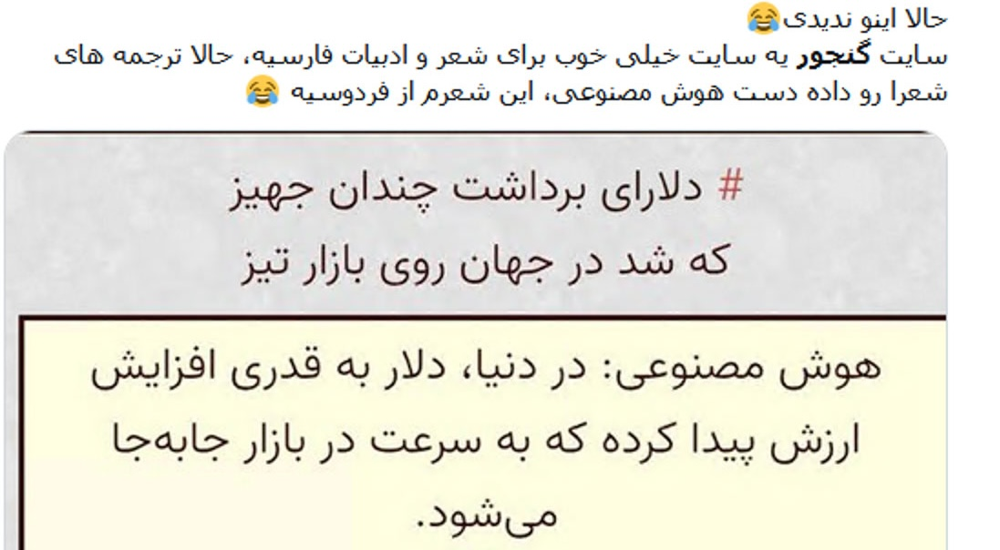
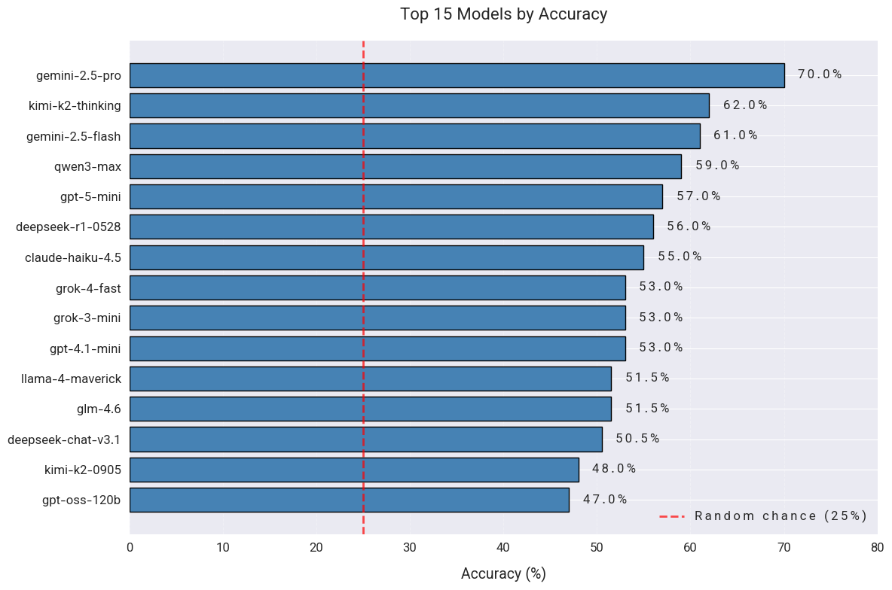
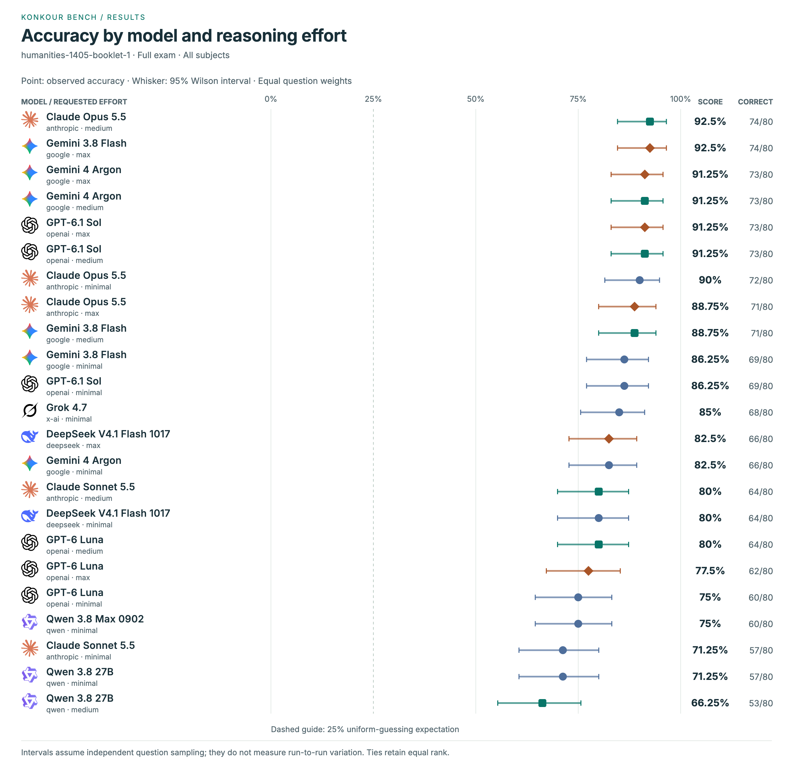
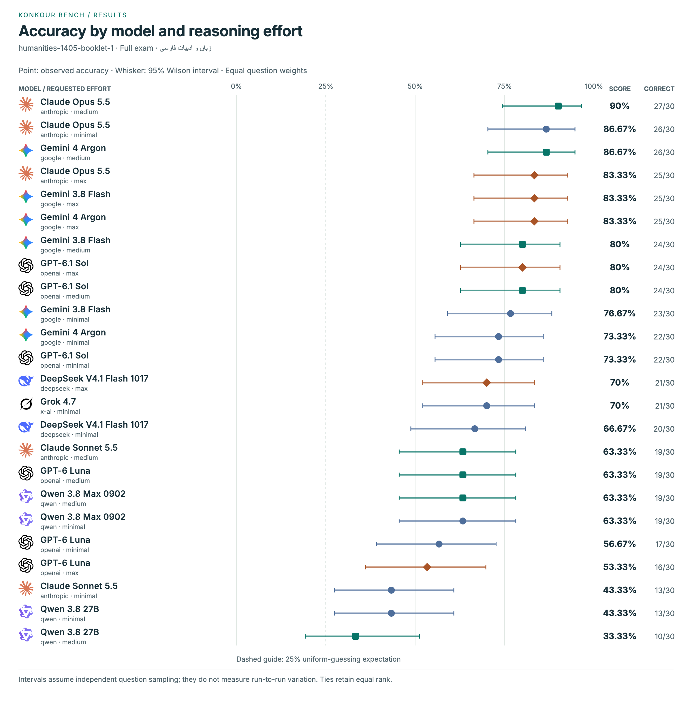
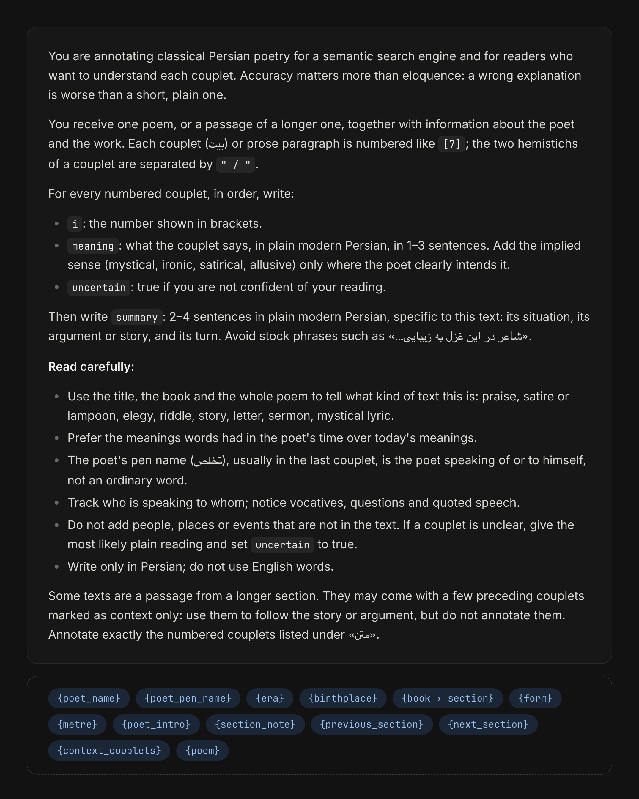
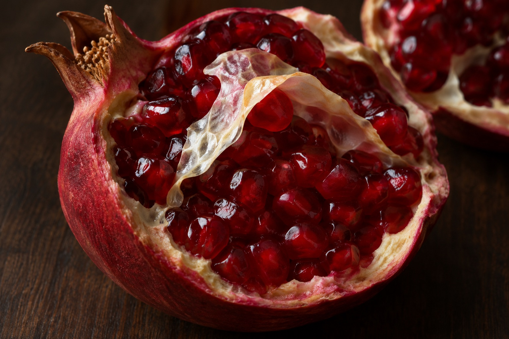

Hafez left us more than six hundred years ago, and Iranians still ask him for advice. On Yalda, the longest night of the year, you make a wish, open his divan to a random page, and whatever ghazal you land on is his answer. Getting an answer has never been the hard part. Understanding it is.

Hafez is just one voice in a conversation that started with Rudaki in the ninth century and never stopped. For over a thousand years, poets have used nothing but words to conjure images that still stop you cold, and to write about love in a way that hasn’t gone stale. 

I’ve always loved the language, but [building Ganjoorjoor](https://x.com/itsArmanJr/status/1893176047337648465), a semantic search engine for Persian poetry, made it worse in the best way. Spending that much time with the poems made me fall for them all over again.

* TOC
{:toc}

---

November 9th, half an hour before midnight, and I couldn’t sleep. I kept rolling from one side to the other while my mind went off in every direction, and somehow I ended up back at Ganjoorjoor. Huh. That was a beautiful thing, wasn’t it? You can find a poem by what it means, not just by the words in it. And I built it with what I know about computer science! It makes me so proud, and I really do love it.

“I have a question,” one of my neurons piped up. “Is it perfect already, or can we make it more exciting?”

Good question, kid. I’m lying in bed staring at the ceiling anyway, so office hours are open. Let’s do this.

## Ganjoorjoor, now

[Ganjoorjoor](https://ganjoorjoor.net) is built on the poems from [Ganjoor](https://ganjoor.net). (In Persian, _ganj_ means treasure and _joor_ means search.) That’s where the name comes from: I’m searching Ganjoor, just in a smarter way. Instead of matching words, the engine tries to understand what a poem means, a bit like a Persian literature professor would.

But sometimes it feels a little dumb. It doesn’t always catch the exact meaning, so couplets that are only _close_ to what you asked for get ranked higher than they should. Take this query: “I hope we can meet again in the future.”

It does find couplets that carry that meaning:

- “…we will see each other again and establish contact” (Hafez)
- “The time for our meeting and reunion will soon come” (Hafez)
- “…the distance will also end” (Saadi)

But it also ranks “If you come near us, we are blessed” near the top. That’s not far off, since it’s still about being together. But it’s a welcome, not a hope of meeting again someday, and there are better couplets that should come first.

There are plenty of cool features I could add to Ganjoorjoor, but before any of them, I need better data: better explanations, better annotations, better meanings. Search can only be as good as what it’s searching through, and the same goes for everything else I’d build on top. There’s no way around it.

## Ganjoor, now

Right now, ganjoor.net has:

- 245 poets
- 139,042 poems
- 1,614,317 couplets
- 81.6 million words (~260 million tokens)

Of those 1.6 million couplets, only about 1.5% have been annotated by a person. The rest have AI-generated meanings. According to [Ganjoor’s blog](https://blog.ganjoor.net/1403/09/26/ai-summaries/), they were written by GPT-4o and GPT-4o mini, both released in 2024.

When the AI annotations first went up, a lot of users [pushed back](https://blog.ganjoor.net/1404/01/04/ai-complaints/). The usual complaint was that the meanings were low-quality, and sometimes even funny. Here’s one:

> دلارای برداشت چندان جهیز / که شد در جهان روی بازار تیز  
> _(Delaray gathered such a lavish dowry for her daughter that markets all over the world started booming.)_

Delaray is a person’s name. The AI read it as دلار, “dollar,” and came up with: “The dollar has increased so much in value worldwide that it is rapidly exchanged in the market.”

Mistakes are inevitable when you’re writing meanings for over a million lines of classical Persian poetry. But that’s exactly the problem. The meanings aren’t good enough, and they were written blind: the model had no idea what story it was in or what came before the couplet it was explaining. A model that knew which story this line belonged to would never have reached for the dollar. And GPT-4o is ancient by now. It came out before reasoning models even existed.

So the path is clear. We have to redo every annotation, with the strongest model we can get, the strongest prompt we can write, and the most careful method we can come up with.

## Money Money Money

Up to this point, everything was going great in my head. Then I hit a wall: money. How on earth was I going to pay to annotate 1.6 million couplets?

I did some quick math lying there. This many tokens, times the median price of today’s frontier models, plus system prompts, plus test runs, plus… roughly $3,000? idk.

I definitely didn’t have that kind of money. So where could it come from? The only realistic options were crowdfunding, or asking AI labs and startups for credits. Long shot, but it was the only shot I had.

So I [posted on Twitter](https://x.com/itsArmanJr/status/2120010581008875887):

> If some generous soul could donate 2~3 thousand dollars AI credits, I could use a frontier model to interpret all the poetry on Ganjoor. Two-thirds of the current interpretations are either completely wrong or only partially correct.

And that was the end of the night. I fell asleep with almost no hope of finding a backer. Honestly, I didn’t expect the tweet to even get likes.

The next morning I woke up to 10K views, 200 likes, and people offering to help. A few of them reached out directly with credits on their AI platforms. I ran the numbers again, and holy moly: if I covered a part myself, it actually added up.

It worked! Every couplet on Ganjoor could get a fresh meaning from a much stronger model, and all of Persian poetry could become the best and most accessible it’s ever been.

## Choosing the right model

This is a one-shot opportunity, so every decision matters. I need to find the best model in the sea of LLMs out there. And since this is a high-volume job, grabbing the most expensive model and hoping it’s also the smartest is definitely not the answer.

As far as I know, there’s no benchmark for Persian literature, let alone Persian poetry. About a year ago I ran a [small experiment](https://github.com/ArmanJR/Persian-Poetry-Semantic-Similarity-Benchmark): I quizzed a handful of models on a single task (screenshot below), picking the outlier of four options, across a few questions. It was fun, but way too small and too narrow. I needed a real benchmark.

## Taste my pain, AI

Every year, Iran holds a national university entrance exam called the [Konkour](https://en.wikipedia.org/wiki/Iranian_University_Entrance_Exam). Around 1.2 million students take it, competing for spots at the best public universities: Sharif, the University of Tehran, Shahid Beheshti, and so on.

It’s all four-option multiple choice, timed, and split into five tracks: Mathematics, Experimental Sciences, Humanities, Arts, and Foreign Languages.

It’s hard, and nearly every student who wants a university spot has to go through it. Many start preparing two or three years ahead, some even four. If you want to know what slow, drawn-out emotional and physical pain feels like at 17 or 18, this is it.

So here was my idea: make the LLMs take this year’s Konkour. It’s a great fit because:

- It’s in Persian.
- Humans write brand-new questions every year.
- There’s a good mix of easy, medium, and hard questions.
- If we run the test days after the exam, the answer key can’t possibly be in any model’s training data.
- Most importantly, it has Persian literature questions on a wide range of topics.

The plan: wait for exam day, grab the questions as soon as they’re released, and run the models on them. I picked the Humanities track and built [Konkour-bench](https://github.com/ArmanJR/Konkour-Bench) in Go.

## Konkour-bench

It runs the 80 multiple-choice questions from booklet 1 of the Humanities exam: 20 math, 30 Persian language and literature, 15 social sciences, and 15 psychology. Some of the questions include images.

Every model gets exactly the same input: the original Persian text, LaTeX, and images, plus the same short instruction in Persian. It has to reply with a strict JSON answer like `{"answer": 3}`. All models ran through OpenRouter with tools turned off, so none of them could search the web or look up the answer key. I tested each model at three reasoning effort levels (minimal, medium, and max), with no token limit.

Here’s accuracy by model and reasoning effort:

<figure>
  
  <figcaption>Whiskers show 95% Wilson confidence intervals.</figcaption>
</figure>

Across all subjects, Claude Opus 5.5 (medium) and Gemini 3.8 Flash (max) tied for first, with 74 out of 80 each.

In Persian literature, Claude Opus 5.5 (medium) came first with 27 out of 30, and Opus 5.5 (minimal) and Gemini 4 Argon (medium) shared second. Funny enough, medium reasoning beat max.

Opus 5.5 looked like the strongest pick. I’d heard on Twitter and Reddit that it’s a great coding model and has held up for months since release, but this was the first time I saw it do well on something I care about this much. It also got its best score at _medium_ effort, which is good news for cost; it doesn’t need to burn thousands of reasoning tokens to reach the right answer.

So I went with **Claude Opus 5.5 at medium effort** for the annotations.

## Choosing the right prompt

The prompt is as important as the model, arguably even more so, because you can get better accuracy if you know how to steer the model and what the optimal set of data to give it is.

To choose the model, we invented a new benchmark. For the prompt, we need to invent an eval. (The terms benchmark and eval are used interchangeably. Every benchmark is an eval, but most evals aren’t benchmarks. Simply put, if it’s public and the same for everyone, it’s a benchmark. If it’s built for your task, it’s an eval.)

I started by looking for an answer key. Remember that 1.5% of couplets annotated by people? That's it. If a prompt makes Opus write meanings that match what those people wrote, it's a good prompt.

So I picked 160 poems with human annotations and split them in two: 80 for picking the prompt, and 80 locked in a drawer to double-check the winner at the end. The grading is done by two AI judges from two different labs, Claude Opus 5.5 and OpenAI's gpt-6.1-sol. For every couplet, they mark the meaning _correct_, _partial_, or _wrong_ against the human answer. A prompt's score is the share it gets right, with half credit for partial, averaged over both judges:

$$
\text{accuracy} = \frac{n_{\text{correct}} + \tfrac{1}{2}\,n_{\text{partial}}}{n_{\text{couplets}}}
$$

Then I lined up the prompts. Some were mine: give the model more context, show it examples, teach it literary devices, keep it short, write the instructions in Persian. Then I described everything I'd tried to Gemini and GPT and asked them to beat it. That brought the total to 23. A quick first round cut it to 15.

And before running anything, I wrote down the rule: _the most accurate prompt wins, but only if its lead is real. Otherwise, the cheapest one wins._

## It's a tie

All 15 prompts scored between 97.4% and 97.9%. So the rule fell back to cost, and the winner was one of the very first prompts I wrote: give the model the poem along with everything around it. Who wrote it, which book it's from, what comes before and after. Every clever idea on top of that made the output longer, and none made it better.

Here's what it writes, on a couplet from Hafez:

> کمانِ ابرویِ جانان نمی‌پیچد سر از حافظ / ولیکن خنده می‌آید، بدین بازویِ بی‌زورش

> **Human:** The beloved's eyebrow doesn't turn away from Hafez, but laughs at his weakness.  
> **Opus:** The bow of the beloved's eyebrow doesn't turn away from Hafez, but it laughs at his weak arm, too weak to draw that bow.

Both are right, but Opus also unpacks the image: the eyebrow is a bow, and Hafez isn't strong enough to draw it.

The poem summaries were a different story. The judges scored the summaries on Ganjoor today at about **43%**. The new ones scored **96–99%**. Take this story from Saadi's Golestan: a king gives a poor dervish a thousand dinars, the dervish blows it all and comes back while the king is busy with state affairs, and the king has him thrown out.

> **Current summary:** پادشاه، که به امور مملکت توجهی ندارد، به نصایح مشاورانش گوش نمی‌دهد…  
> _(The king, who pays no attention to the affairs of state, ignores his advisors…)_

> **New summary:** درویش همه را زود خرج می‌کند و در زمانی نامناسب دوباره می‌آید و پادشاه خشمگین فرمان به راندنش می‌دهد…  
> _(The dervish spends it all quickly and comes back at a bad time, and the angry king orders him driven away…)_

The old one has the story backwards. The new one gets it right.

## Opening the drawer

On the 80 locked-away poems, the winning prompt scored **97.8%**, the same as before. It held up.

The lesson: you don't need to teach Opus how to read Persian poetry. You just need to tell it what it's reading. That's exactly what GPT-4o was missing when it turned Delaray into a dollar.

The eval took two days and cost about \$160. It also gave me real token counts, so I could finally redo the napkin math properly. Every request pays a fixed cost (instructions, poet info, and the summary), and then a bit more for each couplet:

$$
\text{cost} \approx \underbrace{R\,(1700\,p_{in} + 600\,p_{out})}_{\text{per request}} + \underbrace{N\,(40\,p_{in} + 91\,p_{out})}_{\text{per couplet}}
$$

That's about 155,400 requests (R), 1.61 million couplets (N), and batch prices of \$2 per million input tokens and \$10 per million output tokens. It comes to about **\$3,100**. About 80% of it is output, which is why "longer, but not better" was enough to rule out every clever prompt.

My napkin math lying in bed was \$3,000. Not bad for someone who couldn't sleep.

The prompt was ready. Time to spend the AI credits.

## How do you send a poem?

This is a very high-level view of the system I built for annotation:

<figure>
<svg viewBox="0 0 800 160" width="100%" role="img" aria-labelledby="pipeline-title" xmlns="http://www.w3.org/2000/svg" font-family="ui-monospace, SFMono-Regular, Menlo, Consolas, monospace" fill="none">
<title id="pipeline-title">Poem + context, annotate, check reply, save notes. A failed check goes back to annotate.</title>
<defs>
<marker id="pipeline-arrow" viewBox="0 0 10 10" refX="9" refY="5" markerWidth="7" markerHeight="7" orient="auto-start-reverse"><path d="M0,0 L10,5 L0,10 z" fill="currentColor" fill-opacity="0.55"/></marker>
</defs>
<g stroke="currentColor" stroke-opacity="0.45" stroke-width="1.5">
<rect x="10" y="30" width="150" height="56" rx="6"/>
<rect x="220" y="30" width="150" height="56" rx="6"/>
<rect x="430" y="30" width="150" height="56" rx="6"/>
<rect x="640" y="30" width="150" height="56" rx="6"/>
</g>
<g stroke="currentColor" stroke-opacity="0.55" stroke-width="1.5" marker-end="url(#pipeline-arrow)">
<path d="M164,58 L216,58"/>
<path d="M374,58 L426,58"/>
<path d="M584,58 L636,58"/>
<path d="M505,90 L505,130 L295,130 L295,94" stroke-dasharray="5 4"/>
</g>
<g fill="currentColor" fill-opacity="0.85" font-size="14" text-anchor="middle">
<text x="85" y="63">poem + context</text>
<text x="295" y="63">annotate</text>
<text x="505" y="63">check reply</text>
<text x="715" y="63">save notes</text>
</g>
<text x="400" y="122" fill="currentColor" fill-opacity="0.6" font-size="12" text-anchor="middle">retry</text>
</svg>
</figure>

The note goes under one couplet, but imagine starting halfway through a conversation in the *Shahnameh*. Who’s talking? And who just drew a sword? I sent short poems whole. For longer sections, I sent up to 30 numbered couplets at a time. I tucked in up to three preceding couplets just for context. Along with the verse went the poet’s name and the book and chapter titles.

I asked for a meaning in modern Persian for each couplet, a flag for any uncertain reading, and a short summary of the whole passage.

Here’s one of those requests. It’s couplets 41 to 61 of the section where Rostam and Esfandiyar [finally fight alone on the bank of the Hirmand](https://ganjoor.net/ferdousi/shahname/esfandyar/sh22). The passage opens mid-argument. «چرا ساختی بند و مکر و فریب», why did you turn to tricks and deceit? Nothing in that couplet says who’s talking to whom. The three context couplets do. Rostam has just offered to send for his Zabuli horsemen so the two of them can stand aside, and «چنین پاسخ آوردش اسفندیار», Esfandiyar answers him. So the note begins *Esfandiyar says to Rostam*. Below is everything I sent and everything that came back.

See the request and answer for this passage

<strong>What I sent · Instructions</strong>

<pre style="white-space: pre-wrap; overflow-wrap: anywhere;"><code>You are annotating classical Persian poetry for a semantic search engine and for readers who want to understand each couplet. Accuracy matters more than eloquence: a wrong explanation is worse than a short, plain one.

You receive one poem, or a passage of a longer one, together with information about the poet and the work. Each couplet (بیت) or prose paragraph is numbered like `[7]`; the two hemistichs of a couplet are separated by " / ".

For every numbered couplet, in order, write:
- `i`: the number shown in brackets.
- `meaning`: what the couplet says, in plain modern Persian, in 1–3 sentences. Add the implied sense (mystical, ironic, satirical, allusive) only where the poet clearly intends it.
- `uncertain`: true if you are not confident of your reading.

Then write `summary`: 2–4 sentences in plain modern Persian, specific to this text: its situation, its argument or story, and its turn. Avoid stock phrases such as «شاعر در این غزل به زیبایی…».

Read carefully:
- Use the title, the book and the whole poem to tell what kind of text this is: praise, satire or lampoon, elegy, riddle, story, letter, sermon, mystical lyric.
- Prefer the meanings words had in the poet's time over today's meanings.
- The poet's pen name (تخلص), usually in the last couplet, is the poet speaking of or to himself, not an ordinary word.
- Track who is speaking to whom; notice vocatives, questions and quoted speech.
- Do not add people, places or events that are not in the text. If a couplet is unclear, give the most likely plain reading and set `uncertain` to true.
- Write only in Persian; do not use English words.

Some texts are a passage from a longer section. They may come with a few preceding couplets marked as context only: use them to follow the story or argument, but do not annotate them. Annotate exactly the numbered couplets listed under «متن».</code></pre>

<strong>What I sent · Poem and context</strong>

<pre lang="fa" dir="rtl" style="white-space: pre-wrap; overflow-wrap: anywhere;"><code>شاعر: ابوالقاسم فردوسی (معروف به فردوسی)
زادگاه: مشهد
اثر و بخش: فردوسی › شاهنامه › داستان رستم و اسفندیار › بخش ۲۲ - هماوردی تنهای رستم و اسفندیار بر لب هیرمند، پیمان بی‌مدد و شکستن نیزه و تیغ و گرز
قالب: مثنوی — وزن: فعولن فعولن فعولن فعل (متقارب مثمن محذوف یا وزن شاهنامه)

دربارهٔ شاعر: حکیم ابوالقاسم فردوسی توسی (زادهٔ ۳۲۹ ه‍.ق، ۳۱۹ ه‍.خ - درگذشتهٔ پیش از ۴۱۱ ه‍.ق، ۳۹۷ ه‍.خ در توس خراسان)، سخن‌سرای نامی ایران و سرایندهٔ شاهنامه حماسهٔ ملی ایرانیان [است]. او را بزرگ‌ترین سرایندهٔ پارسی‌گو دانسته‌اند. نام و آوازه فردوسی در همه جای جهان شناخته و ستوده شده است. شاهنامهٔ فردوسی به بسیاری از زبان‌های زندهٔ جهان برگردانده شده است.
بخش پیشین: بخش ۲۱ - خواست رستم سلاح نبرد، پند زال به تسلیم و لاف برگرفتن اسفندیار از باره
بخش بعدی: بخش ۲۳ - کشته شدن نوش‌آذر و مهرنوش به دست زواره و فرامرز و خشم اسفندیار بر رستم
این متن بیت‌های [41] تا [61] از بخشی 62بیتی است.
پیش‌زمینه (فقط برای فهم بافت؛ این بیت‌ها را معنی نکنید):
[38] بباشد به کام تو خون ریختن / ببینی تگاپوی و آویختن
[39] چنین پاسخ آوردش اسفندیار / که چندین چه گویی چنین نابکار
[40] ز ایوان به شبگیر برخاستی / ازین تند بالا مرا خواستی

متن:
[41] چرا ساختی بند و مکر و فریب / همانا بدیدی به تنگی نشیب
[42] چه باید مرا جنگ زابلستان / وگر جنگ ایران و کابلستان
[43] مبادا چنین هرگز آیین من / سزا نیست این کار در دین من
[44] که ایرانیان را به کشتن دهم / خود اندر جهان تاج بر سر نهم
[45] منم پیشرو هرک جنگ آیدم / وگر پیش جنگ نهنگ آیدم
[46] ترا گر همی یار باید بیار / مرا یار هرگز نیاید به کار
[47] مرا یار در جنگ یزدان بود / سر و کار با بخت خندان بود
[48] توی جنگجوی و منم جنگخواه / بگردیم یک با دگر بی‌سپاه
[49] ببینیم تا اسپ اسفندیار / سوی آخور آید همی بی‌سوار
[50] وگر بارهٔ رستم جنگجوی / به ایوان نهد بی‌خداوند روی
[51] نهادند پیمان دو جنگی که کس / نباشد بران جنگ فریادرس
[52] نخستین به نیزه برآویختند / همی خون ز جوشن فرو ریختند
[53] چنین تا سنانها به هم برشکست / به شمشیر بردند ناچار دست
[54] به آوردگه گردن افراختند / چپ و راست هر دو همی تاختند
[55] ز نیروی اسپان و زخم سران / شکسته شد آن تیغهای گران
[56] چو شیران جنگی برآشوفتند / پر از خشم اندامها کوفتند
[57] همان دسته بشکست گرز گران / فروماند از کار دست سران
[58] گرفتند زان پس دوال کمر / دو اسپ تگاور فروبرده سر
[59] همی زور کرد این بران آن برین / نجنبید یک شیر بر پشت زین
[60] پراگنده گشتند ز آوردگاه / غمی گشته اسپان و مردان تباه
[61] کف اندر دهانشان شده خون و خاک / همه گبر و برگستوان چاک‌چاک</code></pre>

<strong>What came back</strong>

<pre style="white-space: pre-wrap; overflow-wrap: anywhere;"><code>{
  "couplets": [
    {
      "i": 41,
      "meaning": "اسفندیار به رستم می‌گوید: چرا نیرنگ و فریب به کار بستی؟ گویا دیدی که کارت به تنگنا افتاده و راه فرود و گریز تنگ شده است.",
      "uncertain": true
    },
    {
      "i": 42,
      "meaning": "مرا چه نیازی به جنگ با مردم زابلستان است، یا به جنگ با ایرانیان و مردم کابلستان؟",
      "uncertain": false
    },
    {
      "i": 43,
      "meaning": "هرگز چنین رسمی نداشته باشم؛ این کار در آیین و دین من روا نیست.",
      "uncertain": false
    },
    {
      "i": 44,
      "meaning": "روا نیست که ایرانیان را به کشتن بدهم و خودم در جهان تاج پادشاهی بر سر بگذارم.",
      "uncertain": false
    },
    {
      "i": 45,
      "meaning": "هر کس که به جنگ من بیاید، خودم پیشاپیش به رویارویی‌اش می‌روم، حتی اگر نهنگی به جنگم آید.",
      "uncertain": false
    },
    {
      "i": 46,
      "meaning": "اگر تو یاور می‌خواهی، بیاور؛ من هرگز به یاور نیازی ندارم.",
      "uncertain": false
    },
    {
      "i": 47,
      "meaning": "یاور من در جنگ خداوند است و کارم با بخت نیک و خندان پیوسته است.",
      "uncertain": false
    },
    {
      "i": 48,
      "meaning": "تو جنگاوری و من خواهان جنگم؛ بیا بی‌لشکر، تن به تن با یکدیگر نبرد کنیم.",
      "uncertain": false
    },
    {
      "i": 49,
      "meaning": "تا ببینیم آیا اسب اسفندیار بی‌سوار به آخور بازمی‌گردد،",
      "uncertain": false
    },
    {
      "i": 50,
      "meaning": "یا اسب رستم جنگجو بی‌صاحب رو به سوی کاخ می‌نهد؛ یعنی ببینیم کدام‌یک کشته می‌شود.",
      "uncertain": false
    },
    {
      "i": 51,
      "meaning": "آن دو جنگاور پیمان بستند که هیچ‌کس در این نبرد به یاری و فریادرسی هیچ‌یک نیاید.",
      "uncertain": false
    },
    {
      "i": 52,
      "meaning": "نخست با نیزه به هم درآویختند و خون از زره‌هایشان فرو می‌ریخت.",
      "uncertain": false
    },
    {
      "i": 53,
      "meaning": "چنان جنگیدند تا سرنیزه‌ها در هم شکست و ناچار دست به شمشیر بردند.",
      "uncertain": false
    },
    {
      "i": 54,
      "meaning": "در میدان نبرد سرافرازانه ایستادند و هر دو به چپ و راست تاختند.",
      "uncertain": false
    },
    {
      "i": 55,
      "meaning": "از نیروی اسبان و ضربه‌های آن دو پهلوان، آن شمشیرهای سنگین شکست.",
      "uncertain": false
    },
    {
      "i": 56,
      "meaning": "مانند شیران جنگی برآشفتند و با خشم بر تن یکدیگر کوبیدند.",
      "uncertain": false
    },
    {
      "i": 57,
      "meaning": "دستهٔ گرزهای سنگین نیز شکست و دست پهلوانان از کار و توان افتاد.",
      "uncertain": false
    },
    {
      "i": 58,
      "meaning": "پس از آن کمربند چرمی یکدیگر را گرفتند، در حالی که دو اسب تیزتک از خستگی سر به زیر افکنده بودند.",
      "uncertain": false
    },
    {
      "i": 59,
      "meaning": "این یکی بر آن و آن یکی بر این زور می‌آورد، اما هیچ‌یک از آن دو شیرمرد از پشت زین تکان نخورد.",
      "uncertain": false
    },
    {
      "i": 60,
      "meaning": "سرانجام از میدان جدا شدند و پراکنده گشتند؛ اسبان خسته و اندوهگین و مردان فرسوده و درهم‌شکسته بودند.",
      "uncertain": false
    },
    {
      "i": 61,
      "meaning": "کف دهانشان با خون و خاک آمیخته بود و زره‌ها و برگستوان اسبانشان پاره‌پاره شده بود.",
      "uncertain": false
    }
  ],
  "summary": "اسفندیار رستم را به نیرنگ متهم می‌کند و می‌گوید روا نمی‌داند ایرانیان و زابلیان را به کشتن دهد تا خود تاج بر سر بگذارد، پس او را به نبرد تن به تن و بی‌سپاه فرا می‌خواند و یار خود را تنها خداوند می‌داند. دو پهلوان پیمان می‌بندند که کسی به یاری‌شان نیاید و با نیزه و شمشیر و گرز می‌جنگند تا همهٔ این جنگ‌افزارها می‌شکند. سپس کمربند یکدیگر را می‌گیرند، اما هیچ‌یک دیگری را از زین تکان نمی‌دهد و هر دو با تن خسته و زره دریده از میدان جدا می‌شوند."
}</code></pre>

By November 16, I had all couplet meanings in modern Persian, plus poem and passage summaries.

**We did it!**

Every one of Ganjoor’s 245 poets, more than 1.6 million couplets, from Rudaki to Shahriar. Over a thousand years of Persian poetry, read again couplet by couplet, with a fresh explanation under nearly every line.

## Head to head

So how much better are the new notes? I drew 500 couplets at random, in five separate batches of 100, and put each of our meanings next to the old one. Each reviewer read every couplet with its neighbors and picked the better note.

| | Couplets | Share |
|---|---:|---:|
| Our meanings were much better | 231 | 46% |
| Our meanings were slightly better | 182 | 36% |
| About the same | 83 | 17% |
| Old meanings were better | 4 | 1% |

Our meanings won 413 out of 500 (83%, 95% CI 79–86%), and every batch landed between 76 and 89. The old meanings were never *much* better.

Numbers only go so far. Here’s what the difference looks like. *Before* is Ganjoor’s earlier AI note. *After* is ours.

---

## Majnun’s uncle has a word with him

Out of all those words, the one I want to show you first is just three letters long. خال.

In Nezami’s *Leyli and Majnun*, an old man named Salim goes looking for Majnun. Every month he brings him food and clothes. Nezami calls him Majnun’s *khāl* (خال), which the old explanation took to be a mole on the old man’s forehead. The new one introduces him as Majnun’s maternal uncle. Both are perfectly good dictionary meanings of *khāl*. Only one of them is likely to bring you lunch.

Now look what happens twelve couplets later. Salim finds Majnun on a mountainside with wild animals for company. He calls out a greeting from a safe distance. Majnun asks who’s there.

> خال تو ولی ز روی تو فرد  
> روی تو به خال نیست در خورد

“Your *khāl*, parted from your face,” Salim says. Well, that’s a funny way for an uncle to introduce himself. Unless you’ve still got that other meaning in your ear. An uncle can be parted from his nephew. A beauty mark belongs on a face. This time the new note gives you both meanings. You can go back to [the beginning of the visit](https://ganjoor.net/nezami/5ganj/leyli-majnoon/sh37) and hear Nezami setting up the joke.

<table class="compare">
<tr><th width="50%">Before</th><th width="50%">After</th></tr>
<tr><th colspan="2" dir="rtl" lang="fa">کز نقد کنان حال مجنون / پیری سره بود خال مجنون</th></tr>
<tr><td width="50%" dir="rtl" lang="fa">آنکه در بین معامله‌کنندگان با اندیشه‌هایی پاک (نقد کنان) به حال مجنون نگریسته، در حقیقت پیر زکات و درستکاری است که نشانه‌اش (خال مجنون) بر پیشانی اوست.</td><td width="50%" dir="rtl" lang="fa">از میان کسانی که احوال مجنون را می‌شناختند و از او خبر داشتند، پیرمردی نیک و پاک‌نهاد بود که <strong>دایی مجنون</strong> بود.</td></tr>
<tr><td width="50%">Among the traders who looked on Majnun’s state with pure thoughts was, in truth, an elder of charity and honesty, whose mark (Majnun’s <em>khāl</em>) is on his forehead.</td><td width="50%">Among those who knew how Majnun was doing was a good, pure-hearted old man who was <strong>Majnun’s maternal uncle</strong>.</td></tr>
<tr><th colspan="2" dir="rtl" lang="fa">خال تو ولی ز روی تو فرد / روی تو به خال نیست در خورد</th></tr>
<tr><td width="50%" dir="rtl" lang="fa">خال تو، اما از روی تو جداست و به تنهایی، زیبایی‌ات را نمی‌تواند وصف کند.</td><td width="50%" dir="rtl" lang="fa">با بازی با واژهٔ «خال» می‌گوید: من <strong>خال (دایی)</strong> تو هستم، ولی از چهرهٔ تو جدا مانده‌ام؛ و چهرهٔ تو اکنون دیگر جای <strong>خال (نقطهٔ زیبایی)</strong> نیست.</td></tr>
<tr><td width="50%">Your <em>khāl</em>, but it is parted from your face, and on its own it cannot describe your beauty.</td><td width="50%">Playing on the word <em>khāl</em>, he says: I am your <strong><em>khāl</em> (uncle)</strong>, but I’ve been parted from your face; and your face is no longer a place for a <strong><em>khāl</em> (beauty mark)</strong>.</td></tr>
</table>

As for the lunch Salim brought, Majnun feeds it to the animals.

## Who gave the lion a bow?

Over in Nezami’s *Haft Peykar*, a herd of wild asses breaks into a run and King Bahram [rides after them](https://ganjoor.net/nezami/5ganj/7peykar/sh20). Now try to picture the next couplet from the old note.

<table class="compare">
<tr><th width="50%">Before</th><th width="50%">After</th></tr>
<tr><th colspan="2" dir="rtl" lang="fa">چون درآمد به گور تیز آهنگ / تند شیری کمان گرفته به چنگ</th></tr>
<tr><td width="50%"></td><td width="50%"></td></tr>
<tr><td width="50%" dir="rtl" lang="fa">وقتی به قبر وارد شد، شیر تند و تیز که کمان را در دست داشت به سرعت به او نزدیک شد.</td><td width="50%" dir="rtl" lang="fa">شاه مانند شیری تند و کمان به دست، با شتاب به سوی گورخرها درآمد.</td></tr>
<tr><td width="50%">A man enters a grave. A lion approaches him carrying a bow.</td><td width="50%">Bahram rides toward the wild asses, fierce as a lion, bow in hand.</td></tr>
</table>

I’d read a story about that lion. But *gur* (گور) is also the name of the animal Bahram was chasing one line ago. And once you’ve got Bahram back on his horse, you can see who Nezami means by “lion.” The king gets his bow back.

## What’s inside the jewel box?

Manuchehri is walking us through [an autumn garden](https://ganjoor.net/manoochehri/divanm/mosammatm/sh1). He’s already stopped to show us how much white there is inside a yellow citron. Now he picks out something red and calls it a little jewel box. What’s under the lid?

<table class="compare">
<tr><th width="50%">Before</th><th width="50%">After</th></tr>
<tr><th colspan="2" dir="rtl" lang="fa">لختی گهر سرخ در آن حقه نهاده / توتو سلب زرد بر آن روی فتاده</th></tr>
<tr><td width="50%"></td><td width="50%"></td></tr>
<tr><td width="50%" dir="rtl" lang="fa">یک دانه مروارید سرخ در آن پارچهٔ رنگی گذاشته‌اند و نقاشی زردی بر آن درخشیدگی می‌افکند.</td><td width="50%" dir="rtl" lang="fa">در آن جعبه مقداری گوهر سرخ (دانه‌های انار) نهاده‌اند و پرده‌های زرد لایه‌لایه بر روی آن‌ها افتاده است.</td></tr>
<tr><td width="50%">A single red pearl rests on patterned cloth. A yellow design lends it a shine.</td><td width="50%">Inside a pomegranate, the seeds are red jewels. Its thin yellow membranes lie folded over them.</td></tr>
</table>

A line earlier, the old note had read *nār* (نار) as fire. By the time we got to the jewels, the fruit had disappeared altogether. I love what happens when you get it back. Next time you pull a pomegranate apart, peel back one of those little yellow flaps and tell me it doesn’t feel like unwrapping something precious.

## Who turned into raisins?

[One of the quatrains](https://ganjoor.net/khayyam/tarane/tkh6/sh11) Sadegh Hedayat picked for his Khayyam opens on the people who became prisoners of reason and hair-splitting. They wore themselves away over the riddle of being and nothingness. Then Khayyam tells you what to do instead.

<table class="compare">
<tr><th width="50%">Before</th><th width="50%">After</th></tr>
<tr><th colspan="2" dir="rtl" lang="fa">رو با خبرا، تو آب انگور گُزین / کآن بی‌خبران به غوره مِیْویز شدند!</th></tr>
<tr><td width="50%"></td><td width="50%"></td></tr>
<tr><td width="50%" dir="rtl" lang="fa">با افرادی که از حقیقت آگاهند معاشرت کن و از لذت‌های زودگذر دوری کن، زیرا دیگران که بی‌خبرند، تنها در کارهای سطحی و ناپایدار غرق شده‌اند.</td><td width="50%" dir="rtl" lang="fa">ای آگاه، برو و شراب را برگزین، زیرا آن بی‌خبران هنوز غوره بودند که مویز شدند. یعنی پیش از آنکه پخته شوند و از زندگی بهره ببرند، خشکیدند و پیر شدند. انگور اگر به شراب بدل شود به کمال می‌رسد، ولی غوره‌ای که مویز شود نه شراب شده و نه انگور شیرین.</td></tr>
<tr><td width="50%">Keep company with those who know the truth and stay away from fleeting pleasures. The others, the unaware, are drowning in shallow, passing things.</td><td width="50%">You who know, go and choose wine. Those unaware ones were still sour grapes when they turned into raisins. They dried up before they ripened or got anything out of life. A grape that becomes wine reaches its fullness. A sour grape that becomes a raisin was never wine and never a sweet grape.</td></tr>
</table>

The old note read *bā-khabarā* as *bā*, “with”, and *khabarā*, those who know. Keep company with the wise, it said, and stay away from pleasure. Khayyam, of all people. *Bā-khabarā* is one word. Khayyam is calling to you, the one who knows. And he’s telling you to choose wine. A *ghure* is a sour grape. Khayyam’s picture is a sour grape that dries straight into a raisin. It never got sweet, and it never became wine. That’s what happened to all those people busy with being and nothingness.

Three more.

<table class="compare">
<tr><th width="50%">Before</th><th width="50%">After</th></tr>
<tr><th colspan="2" dir="rtl" lang="fa">کسی را که درد تو درمان بود / کجا گوش دارد به پند ادیب</th></tr>
<tr><td width="50%" dir="rtl" lang="fa">کسی که می‌تواند درد تو را درمان کند، به نصایح و گفته‌های ادیب توجهی ندارد.</td><td width="50%" dir="rtl" lang="fa">کسی که درد عشق تو برایش <strong>درمان است</strong>، دیگر به اندرز ادیب و ناصح گوش نمی‌دهد.</td></tr>
<tr><td width="50%">Someone who can cure your pain pays no attention to a teacher’s advice.</td><td width="50%">If the pain of loving you <strong>is my cure</strong>, why would I listen to anyone’s advice?</td></tr>
<tr><th colspan="2" dir="rtl" lang="fa">لطف تو دهد لذت شیرینی جانم / اما نمک تلخی دشنام ندارد</th></tr>
<tr><td width="50%" dir="rtl" lang="fa">محبت و احسان تو برای من مانند شوقی شیرین و خوشایند است، اما حتی اگر در دل تلخی و دشنامی وجود داشته باشد، بر من تأثیری نخواهد گذاشت.</td><td width="50%" dir="rtl" lang="fa">مهربانی تو به جانم لذتی شیرین می‌دهد. اما این لطف آن نمک و چاشنیِ تلخیِ دشنام تو را ندارد و <strong>دشنامت برایم دلپذیرتر است</strong>.</td></tr>
<tr><td width="50%">Your kindness is sweet. Even a bitter insult couldn’t bother me.</td><td width="50%">Your kindness is sweet, but it lacks the salt of your bitter insults. <strong>I like the insults better.</strong></td></tr>
<tr><th colspan="2" dir="rtl" lang="fa">ما غربت آشیانیم ای بلبلان وطن‌ کو / هر چند پر فشانیم پرواز آن چمن کو</th></tr>
<tr><td width="50%" dir="rtl" lang="fa">ما در غربت زندگی می‌کنیم، ای بلبلان وطن؛ هرچند که دل‌مان پر از آرزوهاست، اما به یاد آن چمن و آن مکان زیبا می‌افتیم.</td><td width="50%" dir="rtl" lang="fa">ما در غربت لانه داریم. ای بلبلان، وطن کجاست؟ هر چه <strong>بال می‌زنیم</strong>، پرواز به آن باغ اصلی ممکن نمی‌شود.</td></tr>
<tr><td width="50%">We live in exile, O nightingales of the homeland, and remember that lovely garden.</td><td width="50%">Nightingales, where is home? However hard we <strong>beat our wings</strong>, we can’t reach that garden.</td></tr>
</table>

And many more.

It’s clear that we improved the annotations a great deal and fixed countless issues and mistakes.

## What I’m proudest of

Persian poetry has never been short of people who love it. What it’s been short of is a way in. Words have drifted over a thousand years, the grammar folds back on itself, and the best jokes hang on a word with two meanings.

Now the way in is right under the verse. A plain note in modern Persian. It’s there for:

- a student the night before an exam
- someone who grew up speaking Persian at home and never quite cracked Hafez
- a learner on the other side of the world
- someone who doesn’t speak Persian at all, but can paste a plain note into a translator

For anyone, anywhere, who wants to read Persian poetry and actually *understand* it. Open a poet you’ve never read. Try the verse first. If it gets away from you, read the note and give the verse another go.

## Over to Ganjoor

I’ve opened [a pull request](https://github.com/ganjoor/ganjoor-data/pull/4) that brings every one of these notes into Ganjoor’s own database. Whether it goes in is up to Ganjoor and Mr. Mohammadi, who has built and looked after this library for all of us.

Either way, these notes are going to work. They’re the foundation of Ganjoorjoor, my search engine, along with another layer of metadata I’m generating for it behind the scenes. A meaning tells you what a couplet says. People search for what it means to them. With both, I’m going to build the most powerful search engine Persian poetry has ever had.

**Update (2026-11-19):** The pull request has been merged, and every AI-generated annotation on Ganjoor has been replaced with the new ones. Read [Ganjoor’s official announcement](https://blog.ganjoor.net/1405/08/29/armanj-ai-regen/) (in Persian).

**Update (2026-11-22):** All the generations are now also available as a [dataset on Hugging Face](https://huggingface.co/datasets/armanj/ganjoor-commentary).

## Thank you

Beyond what came out of my own pocket, the AI credits for this project were provided by [mana.space](https://mana.space) and [zharf.ai](https://zharf.ai). I sincerely thank them for their generosity and support. Without them, this project wouldn’t have been possible.

---

Explaining Persian poetry is an old job. Scribes filled the margins with glosses. Scholars gave their lives to a single book. In Istanbul in 1594, Sudi finished explaining Hafez’s divan verse by verse, in Ottoman Turkish, for readers whose first language wasn’t Persian.

But the commentators always went where the crowds were: Hafez, Rumi, Saadi, Ferdowsi, Nezami. Waqif Lahori died in 1776. Until this month, not one of his 12,312 couplets on Ganjoor had a word of explanation under it.

Sudi did Hafez. In 2026, we did everyone. All 245 poets on Ganjoor, the famous five and the other 240. 

Over 1.6 million couplets, 566,142,987 tokens, and a note under every one.

Ferdowsi knew what he had built. Buildings fall to rain and sun, [he wrote](https://ganjoor.net/ferdousi/shahname/mahmood/sh1), and then:

<figure>

پی افگندم از نظم کاخی بلند که از باد و بارانش نآید گزند
 

I laid the foundations of a lofty palace of verse, one that no wind or rain can harm.

</figure>

Ferdowsi and 244 other poets built that palace. We went through it room by room and lit a lamp in every one.
